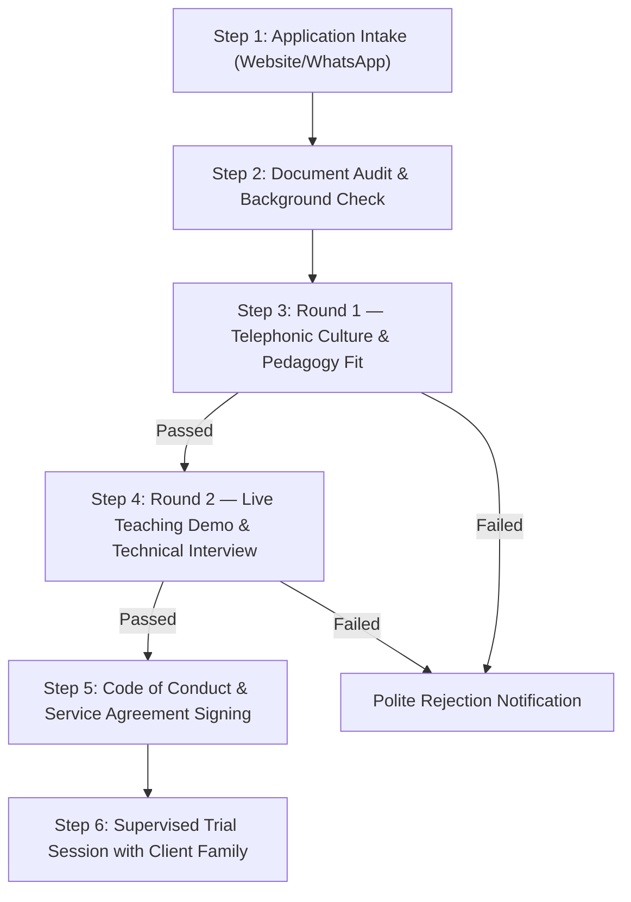

# Spectre Tutors Network
## Standard Operating Procedure (SOP) & Security Protocol: Tutor Onboarding
**Document Reference:** STN-SOP-SEC-01  
**Classification:** Internal Operating Standard  
**Brand Motto:** *“Learn better. With the right tutor.”*  
**Scope:** In-Person 1-on-1 Home Tutoring across Delhi (Classes 6–12: Mathematics, Science, English)  

---

## 1. Executive Intent & Premium Positioning

Spectre Tutors Network operates as an elite, curated educational network—not an open, unvetted gig marketplace. Because our tutors enter client households to mentor secondary and senior secondary students, our onboarding protocol enforces a **zero-compromise security posture** and a **rigorous two-tier interview process**.

Only candidates who demonstrate verifiable academic pedigree, subject mastery, exceptional communication skills, and unblemished character are accepted into the network.

---

## 2. Comprehensive Security & Vetting Protocol

Every prospective tutor must undergo strict, verified identity and academic screening prior to participating in any household session.

### 2.1 Mandatory Document Repository (Collected Before Interview Stage 2)
1. **Government Identity Proof:**
   - Front and back copy of **Aadhaar Card** (Mandatory).
   - Supporting ID: Passport, Voter ID, or Driving License.
   - Verification Check: Cross-verify name, date of birth, and photo. Verify Aadhaar via UIDAI portal if necessary.
2. **Delhi/NCR Residential Verification:**
   - Permanent address proof + current local Delhi residence address (utility bill, rent agreement, or verified college hostel allocation).
3. **Academic Credentials:**
   - Class 10 & Class 12 Board Marksheets (ensuring strong foundations in the target subjects).
   - Undergraduate / Postgraduate Degree Certificate or active College Student ID (DU, IIT Delhi, DTU, NSUT, IPU, or reputed institutions).
4. **Professional & Character References:**
   - Contact details (Phone & Email) of two references:
     - Reference 1: Previous parent whose child was tutored, OR previous employer/coaching institute.
     - Reference 2: Academic reference (Professor, Head of Department, or mentor).

### 2.2 Child Safety & Household Security Rules
- **POCSO Act & Child Safeguarding Awareness:** Every tutor is briefed on zero-tolerance policies regarding physical contact, inappropriate verbal comments, private non-academic messaging, or social media interaction with minors.
- **Open-Door / Guardian Presence Rule:** All in-home sessions must take place in an open common area (e.g., study table in living room or bedroom with door open) with an adult parent or guardian physically present on the premises.
- **Emergency Escalation Pathway:** Tutors and parents are given direct access to the Spectre Coordinator hotline (`+91 92206 38540`) to report any safety, behavioral, or scheduling anomaly immediately.

---

## 3. End-to-End Tutor Onboarding SOP (6-Step Pipeline)

---

### Step 1: Application Intake & Initial Filtering
- **Channel:** Inbound submissions via `/request-tutor?type=tutor` or direct WhatsApp coordinator chat (`+91 92206 38540`).
- **Initial Filter Criteria:**
  - Must teach Mathematics, Science (Physics/Chemistry/Biology), or English for Classes 6–12.
  - Must be located in Delhi and willing to travel within defined neighborhood clusters (e.g. South Delhi, East Delhi, Dwarka, Rohini, North/Central Delhi).
  - Must commit to at least 6 months of weekly scheduling consistency for a student.

---

### Step 2: Document Collection & Background Audit
- The coordinator requests the standard verification pack via secure WhatsApp link or private email.
- **Verification Checklist:**
  - [ ] Aadhaar verification completed.
  - [ ] College enrollment/degree matches claimed qualifications.
  - [ ] Verified local residential address in Delhi.
  - [ ] Clean digital footprint check (LinkedIn, public profiles).

---

### Step 3: Round 1 — Telephonic / Video Screening (15–20 Minutes)
*Conducted by: Spectre Talent Coordinator*

**Objective:** Gauge articulation, tone of voice, empathy, reliability, and teaching philosophy.

#### Interview Questions & Probes:
1. **Background & Motivation:** *"Tell us about your academic journey and what motivated you to pursue 1-on-1 home tutoring in Delhi?"*
2. **Patience & Remediation:** *"How do you handle a Class 9 or 10 student who repeatedly struggles with basic algebra foundations or lacks confidence?"*
3. **Parent Interaction:** *"How do you communicate student progress and homework completion to anxious parents without causing stress?"*
4. **Logistics & Reliability:** *"How do you commute to sessions, and how do you ensure 100% punctuality during board exam prep cycles?"*

*Pass Requirement:* Articulate English/Hindi communication, polite demeanor, clear commitment to student growth, and professional speech.

---

### Step 4: Round 2 — Live Academic Demo & Subject Interview (25–30 Minutes)
*Conducted by: Spectre Senior Academic Evaluator / Founder (via Google Meet / Zoom or In-Person)*

**Objective:** Assess pedagogical depth, board curriculum familiarity (CBSE/ICSE), whiteboard/pen-paper explanation clarity, and ability to make difficult concepts intuitive.

#### Demo Setup:
- Candidate chooses one core topic from the approved syllabus:
  - **Mathematics:** Quadratic Equations, Coordinate Geometry, Trigonometric Identities, or Calculus (Limits/Derivatives).
  - **Science:** Newton's Laws of Motion, Ray Optics, Periodic Trends, Chemical Bonding, or Human Physiology.
  - **English:** Analytical Paragraph Writing, Grammar Syntactical Rules, or Literary Passage Analysis.
- The candidate must deliver a **15-minute live teaching demonstration** as if teaching a student for the first time.
- The interviewer asks 2 unexpected conceptual questions and simulates a student misunderstanding.

---

## 4. Premium Interview Evaluation Scorecard

Use this standardized evaluation rubric during the Round 2 Demo. Each candidate must achieve a minimum score of **20 out of 25** to qualify for network induction.

| Criteria | Max Marks | Description | Candidate Score |
|---|:---:|---|:---:|
| **1. Conceptual Clarity & Accuracy** | 5 | Explains the fundamental "Why" behind formulas/concepts without rote memorization. | / 5 |
| **2. Board Curriculum Mastery** | 5 | Demonstrates thorough knowledge of CBSE/ICSE exam question patterns and marking schemes. | / 5 |
| **3. Communication & Tone** | 5 | Articulate, warm, patient, and audible. Free from harsh reprimands or condescending language. | / 5 |
| **4. Problem-Solving Pedagogy** | 5 | Guides the student step-by-step through first-principles rather than jumping straight to the final answer. | / 5 |
| **5. Professional Polish & Demeanor** | 5 | Punctual, neat grooming, well-prepared notes, structured lesson breakdown. | / 5 |
| **TOTAL SCORE** | **25** | **Minimum Passing Threshold: 20 / 25** | **/ 25** |

**Recommendation:**  
[ ] **ACCEPTED (Tier A — High-Confidence Match)**  
[ ] **PROVISIONAL (Needs mentor guidance on demo delivery)**  
[ ] **REJECTED (Does not meet Spectre quality benchmarks)**  

---

## 5. Tutor Code of Conduct & In-Home Etiquette

All inducted tutors must sign and adhere to these mandatory operational guidelines:

1. **Punctuality:** Arrive 5 minutes before the scheduled hour. If an unavoidable delay arises due to Delhi traffic, inform both the parent and Spectre Coordinator at least 45 minutes in advance.
2. **Professional Attire:** Smart-casual or formal attire. No casual loungewear, offensive graphics, or untidy presentation.
3. **Device Distraction:** Mobile phones must remain on silent throughout the lesson. Taking personal calls or browsing during class is strictly prohibited.
4. **Boundary Adherence:**
   - Maintain a strictly academic relationship with the student.
   - Do not request personal favors, loans, or non-academic assistance from client families.
   - All academic communication with the student should include the parent's contact.
5. **Session Logging:** After every class, submit a 2-line WhatsApp lesson log to the Spectre Coordinator (e.g. *"Covered Trigonometric Identities Ex 8.3; homework assigned Q1–Q10; student grasped identity proofs well"*).

---

## 6. Non-Circumvention (Anti-Poaching) & Financial Terms

To preserve business continuity and protect institutional investment:

- **Non-Circumvention Period:** For any client introduced by Spectre Tutors Network, the tutor agrees not to enter into direct, private financial arrangements with the client family for a period of **12 months** following the introduction.
- **Bypass Penalty:** A breach of this covenant results in immediate termination from the Spectre Network, forfeiture of pending dues, and revocation of institutional letters of recommendation.
- **Transparent Commission Structure:**
  - *Standard Tier:* 40% of the first calendar month's tuition fee is retained by Spectre as the placement/matching fee; 100% of subsequent months' agreed hourly/monthly rate goes to the tutor (or mutually agreed agency structure).
  - Payment schedules are documented in writing before the first trial class.

---

## 7. First In-Home Trial Session Protocol

The first session is a structured, paid trial/assessment class:

1. **Pre-Visit Briefing:** Spectre Coordinator sends the tutor an intake sheet detailing the student's current grades, syllabus status, and specific learning difficulties (e.g. concept clarity vs. exam prep).
2. **Tutor Check-In:** Tutor sends a quick WhatsApp text to the Coordinator upon arrival at the student's residence.
3. **The First 60 Minutes:**
   - First 10 mins: Ice-breaking, reviewing the student's current textbook and school notebooks.
   - Next 40 mins: Teaching a core concept and solving 3 graduated practice problems together.
   - Final 10 mins: Brief verbal update to the parent highlighting strengths and the 3-week study roadmap.
4. **The 24-Hour Feedback Loop:**
   - Spectre Coordinator calls the parent within 24 hours to capture structured feedback.
   - If both sides approve, the regular monthly schedule is formalized.
   - If compatibility is lacking, Spectre arranges a replacement tutor at no extra penalty to the parent.

---

## 8. Incident Reporting & Dispute Management

In the rare event of a dispute, grievance, or safety concern:

| Trigger Event | Immediate Action | Resolution Window |
|---|---|:---:|
| **Unannounced Absence / Extreme Tardiness** | Tutor is flagged; Coordinator contacts parent to reschedule; fee credited. | < 2 Hours |
| **Academic Incompatibility** | Coordinator reviews session notes, gathers parent feedback, and assigns a replacement tutor. | < 48 Hours |
| **Safety / Behavioral Breach** | Immediate suspension of tutor; full parent interview; documentation archived; escalated to legal authorities if warranted. | Immediate (< 1 Hour) |

---
*Maintained and governed by the Operations & Quality Team at Spectre Tutors Network, Delhi.*  
*For questions or updates to this SOP, contact: operations@spectretutors.in / WhatsApp: +91 92206 38540.*
