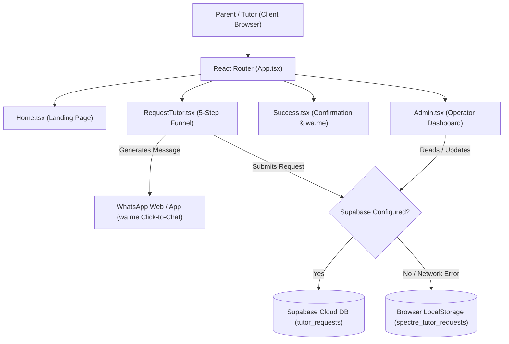

# Spectre Tutors Network — Website Inspection & Handover Report

**Inspection Date:** 28 October 2026  
**Auditor:** Antigravity AI Senior Frontend & Architecture Auditor  
**Local Environment Status:** Running locally at `http://localhost:5173/` (Vite dev server, Port 5173 active)  
**Production Build Status:** Passed (`npm run build` — `tsc -b && vite build` built in 791ms without errors)  
**Node Version:** v24.20.0 | **OS:** Windows 11  
**Project Workspace:** `C:\Users\Hp\Desktop\i-search stutors`  
**Brand Identity:** Spectre Tutors Network — *“Learn better. With the right tutor.”*  
**Core Service:** Delhi-focused 1-on-1 In-Person Home Tutoring for Classes 6–12 (Mathematics, Science, English)  

---

## 1. Executive Summary

Spectre Tutors Network is an early-stage, parent-first web application designed to connect parents in Delhi with vetted 1-on-1 home tutors for Mathematics, Science, and English (Classes 6–12). The product deliberately avoids complex marketplace bidding, algorithmic self-service matching, in-app messaging, or automated third-party bots (such as CallMeBot). Instead, it adopts a **human-curated, WhatsApp Click-to-Chat workflow** backed by an internal operator portal and optional Supabase cloud storage (with automatic LocalStorage fallback).

The website was inspected in both desktop (1280×900 and full vertical scroll 1280×4000) and mobile (390×844) viewports. Visual screenshots were captured using Microsoft Edge headless rendering.

### Overall Assessment
- **Core Functionality:** **Operational & Fast.** The 5-step tutor request funnel, role toggle (Parent vs. Educator), Delhi locality autocomplete, strict numeric phone sanitization, pre-formatted WhatsApp message generator, and Operator Admin Portal are functional.
- **Design Quality:** **High.** Deep academic navy (`#172B4D`), warm parchment background (`#FFFDF8`), clean typography (Manrope & Inter), and purposeful cards. Avoids generic AI glassmorphism or distracting gradients.
- **Critical Risk Prior to Public Launch:** The Operator Admin Portal (`/admin`) is currently completely unauthenticated. Anyone navigating to `/admin` can view sensitive parent/tutor phone numbers, residential addresses, and export customer data via CSV. This must be protected before deploying to production.
- **Responsive Layout Flaw:** On narrow mobile viewports (<400px), certain horizontal elements (role switch buttons, 5-step indicator labels, and hero badges) cause horizontal overflow, clipping text and pushing the navbar hamburger menu off-screen.

---

## 2. Confirmed Pages and Routes

Inspection of `src/App.tsx` and the codebase confirms that the application defines exactly **4 active routes**. There are no hidden or nested route modules.

| Route | Component | Intended Audience | Status | Notes |
|---|---|---|---|---|
| `/` | `Home.tsx` | Parents & Prospective Tutors | Complete | Full landing page: Hero, Trust Strip, Child Needs, Subjects, How It Works, Why Spectre, Trust/Vetting, Final CTAs, FAQ, Footer. |
| `/request-tutor` | `RequestTutor.tsx` | Parents (`user_type: 'parent'`) & Tutors (`user_type: 'tutor'`) | Complete | 5-step guided form with step indicators, Delhi locality autocomplete, complete house address field, numeric phone lock, and WhatsApp handoff. |
| `/request-success` | `Success.tsx` | Parents & Tutors post-submission | Complete | Confirmation screen with direct `wa.me` button, message preview card, copy-to-clipboard button, and next steps. |
| `/admin` | `Admin.tsx` | Spectre Operators / Admin | Functional (Security Concern) | Unauthenticated dashboard showing all requests, status toggles (New, Contacted, Matched, Closed), modal details, WhatsApp reply links, and CSV export. |

### Verified Non-Existent Routes
The following routes **do not exist** in the codebase:
- `/login` / `/signup`: **Do not exist.** The platform is deliberately account-free for parents.
- `/tutors` / `/directory`: **Do not exist.** The platform does not operate a public tutor marketplace; matching is handled privately by human coordinators.
- `/tutor/:id` (Individual tutor profiles): **Do not exist.**
- `/dashboard` (Parent or Tutor self-service portal): **Does not exist.**
- Catch-all / 404 Route (`*`): **Does not exist.** Entering an invalid URL renders a blank white area below the navbar and footer.

---

## 3. Page-by-Page Visual Descriptions

### Page 1: Homepage (`/`)
- **Header / Navbar:** Sticky bar with warm parchment background (`bg-parchment/95`), logo icon with book insignia, brand title *"Spectre Tutors Network"*, subtitle *"Delhi · Classes 6–12"*, anchor links (*How It Works*, *Why Spectre*, *Subjects*, *FAQ*), secondary button (*"Become a Tutor"*), and primary button (*"Request a Tutor"*).
- **Hero Section:**
  - *Location Badge:* “Delhi · 1-on-1 Home Tuition · Classes 6–12” in blue badge.
  - *Main Headline:* “The right tutor can change how a child feels about learning.” (Manrope ExtraBold 48px).
  - *Supporting Copy:* “Find a trusted 1-on-1 home tutor for Mathematics, Science or English. Tell us what your child needs, and we’ll help you find a suitable tutor.”
  - *CTAs:* Primary dark navy button `Request a Tutor →`, secondary white button `Become a Tutor`, text link `How It Works →`.
  - *Trust Strip Badges:* “No upfront fees to request”, “Human review for every request”, “In-home 1-on-1 sessions”.
  - *Hero Media Card:* Authentic photo of student and female tutor studying at home desk (`/images/home_tutoring_hero.jpg`), accompanied by an inset card: *"1-on-1 Learning at Home: Personalised attention, paced for your child's curriculum and learning style."*
- **Trust Strip (Section 2):** Three-column card grid: *1-on-1 attention*, *Subject-focused*, *Human matching*.
- **Child Need Selector (Section 3):** Four interactive cards (*Concept Clarity*, *Exam Preparation*, *Confidence Building*, *Catching Up*). Clicking any card navigates to `/request-tutor` with that specific need pre-selected.
- **Subjects Section (Section 4):** Three cards (*Mathematics*, *Science*, *English*) listing detailed curriculum topics and a direct request link.
- **How It Works (Section 5):** 3-step numbered sequence: `01 Tell us what your child needs` → `02 We review your request` → `03 Meet the right tutor`, with a call-to-action button *"Start with Step 1"*.
- **Why Spectre Philosophy (Section 6):** 4 principles: *A tutor who listens*, *A pace that fits*, *Human involvement*, *Focused expertise*.
- **Vetting & Care (Section 7):** Highlight card with shield icon detailing credential verification, Delhi locality matching, and scheduling consistency.
- **CTA Sections (Section 8 & 8B):**
  - Section 8: Navy banner for parents with *"Request a Tutor"* button.
  - Section 8B: Card for Delhi educators with dedicated green WhatsApp styling (`#25D366`) and button *"Become a Tutor"*.
- **FAQ Section (Section 9):** 6 expandable accordion items answering class coverage, subjects, home visit logistics, and matching timelines.
- **Footer:** Brand mission, direct WhatsApp link (`+91 92206 38540`), support email (`hello@spectretutors.in`), navigation links, copyright, and link to `/admin` (*Operator Portal*).

### Page 2: Request Tutor (`/request-tutor`)
- **Header:** Back link `← Back to Spectre Home`.
- **Role Switcher:** Segmented control toggling between:
  - `👨‍👩‍👧 Request a Tutor (Parents)`
  - `🧑‍🏫 Become a Tutor (Educators)`
- **Step Indicator:** 5-step progress bar with step numbers and dynamic labels:
  - Parent Mode: `1. Student` | `2. Subject` | `3. Location` | `4. Schedule` | `5. Contact`
  - Tutor Mode: `1. Level` | `2. Subject` | `3. Location` | `4. Schedule` | `5. Contact`
- **Step 1:** Class pill buttons (Class 6 through 12) + Board options (CBSE, ICSE, State Board, Other, Not sure).
- **Step 2:** Subject checkboxes (Mathematics, Science, English) + Help category buttons + Optional details textarea.
- **Step 3 (Location):**
  - Locality Input with **Delhi Localities Autocomplete**: Dynamic dropdown matching over 120 Delhi neighborhoods (e.g., Saket, Preet Vihar, Rohini, Dwarka) + quick-select chips.
  - **Complete House Address / House No.**: Dedicated text field for flat/house number and street.
  - Landmark / Metro station optional field.
- **Step 4 (Schedule):** Day buttons (Mon–Sun multi-select), Time slot pills (Morning, Afternoon, Evening, Flexible), and Frequency selector.
- **Step 5 (Contact):**
  - Parent/Tutor full name.
  - Phone Number input with **strict numeric enforcement**: Letters and symbols are physically blocked on keydown; paste is sanitized to 10 digits; prepended with `+91`.
  - Email (optional).
  - Summary review box displaying selected level, subjects, locality, and house address.
  - Submit Button: Styled in WhatsApp green (`#25D366`) reading **“Request Tutor on WhatsApp”** (or **“Become a Tutor on WhatsApp”**).

### Page 3: Success Confirmation (`/request-success`)
- **Centerpiece Card:** Blue checkmark icon, *"Your Request is Ready"* heading.
- **Primary WhatsApp Trigger:** Large green card with button **“Open in WhatsApp”** targeting `https://wa.me/919220638540?text=...` in a new tab.
- **Copy Alternative:** “Copy Message” button with instant visual feedback (*Copied Message!*).
- **Pre-filled Message Preview:** Monospace scrollable container displaying the exact generated text, including parent/tutor role header, class, subjects, locality, address, and schedule.
- **What Happens Next:** 3-step explanation of coordinator review and tutor matching.

### Page 4: Spectre Operator Portal (`/admin`)
- **Header:** Title *"Spectre Operator Portal"*, connection badge (*Local Storage Mode* or *Supabase Connected*), *"Refresh"* button, and *"Export CSV"* button.
- **Filter Bar:** Filter pills showing live count: *All (N)*, *New (N)*, *Contacted (N)*, *Matched (N)*, *Closed (N)*.
- **Request Table:** Shows Date, Role (Parent / Tutor), Name, Phone, Class & Board, Subjects, Locality, Status, and Action buttons.
- **Quick WhatsApp Actions:** “Chat on WhatsApp” button pre-fills an admin outreach message directly to the parent or tutor.
- **Details Modal:** Opens complete request details including house address, landmark, schedule, notes, status update buttons, and message copy tool.

---

## 4. Screenshot Inventory

All screenshots were captured live from the running local application (`http://localhost:5173`) using headless Microsoft Edge on 28 October 2026.

| File Path | Viewport | Page / State | Verification |
|---|---|---|---|
| `C:\Users\Hp\Desktop\i-search stutors\screenshots\01_desktop_home_hero.png` | 1280 × 900 | Homepage Hero (Above the Fold) | Verified (397 KB) |
| `C:\Users\Hp\Desktop\i-search stutors\screenshots\02_desktop_home_full.png` | 1280 × 4000 | Complete Homepage (All 9 sections) | Verified (694 KB) |
| `C:\Users\Hp\Desktop\i-search stutors\screenshots\03_desktop_request_parent.png` | 1280 × 900 | Request Tutor — Parent Step 1 | Verified (48 KB) |
| `C:\Users\Hp\Desktop\i-search stutors\screenshots\04_desktop_request_tutor.png` | 1280 × 900 | Request Tutor — Educator Step 1 | Verified (49 KB) |
| `C:\Users\Hp\Desktop\i-search stutors\screenshots\05_desktop_success.png` | 1280 × 900 | Success / WhatsApp Confirmation Screen | Verified (57 KB) |
| `C:\Users\Hp\Desktop\i-search stutors\screenshots\06_desktop_admin.png` | 1280 × 900 | Operator Portal (`/admin`) | Verified (37 KB) |
| `C:\Users\Hp\Desktop\i-search stutors\screenshots\07_mobile_home.png` | 390 × 844 | Mobile Homepage Hero | Verified (118 KB) |
| `C:\Users\Hp\Desktop\i-search stutors\screenshots\08_mobile_request.png` | 390 × 844 | Mobile Request Form Step 1 | Verified (51 KB) |

---

## 5. Brand and Visual Design Audit

### Color Palette (Observed Implementation vs. Specification)
- **Background:** `parchment` = `#FFFDF8` (Warm off-white/cream). Successfully implemented across body, hero, and alternating sections.
- **Primary Navy:** `#172B4D` (Academic Oxford/Slate Navy), with `#0F1D33` (dark) and `#213A65` (light). Used consistently for typography, primary buttons, card headers, and footer.
- **Trust Accent:** `#3B6FF5` (Cobalt blue) and `#EBF1FE` (light tint). Used for badges, active states, focus rings, and icons.
- **WhatsApp Action Green:** `#25D366` (official WhatsApp green) with hover `#20bd5a`. Applied to the submission and contact CTAs.
- **Ink / Typography:** `#172033` (primary body text), `#64748B` (muted subtext), `#94A3B8` (subtle captions).
- **Borders:** `#E2E8F0` (subtle dividers) and `#CBD5E1` (card outlines).

### Typography Hierarchy
- **Headings Font:** `Manrope, sans-serif` (Google Font loaded via `index.html`). Clean geometric structure, weights 600, 700, 800.
- **Body Font:** `Inter, sans-serif` (Google Font loaded via `index.html`). Highly legible at small sizes (12px–16px).
- **Monospace:** System monospace used for generated WhatsApp text previews.

### Component Styling
- **Buttons:** Subtle rounded corners (`rounded-md` / 6px). Primary buttons use solid navy or WhatsApp green with smooth hover transitions. Secondary buttons use clean white borders. No oversized pill shapes or heavy generic gradients.
- **Cards:** Clean 1px borders (`border-border-subtle`), white background, subtle drop shadows (`shadow-xs` / `shadow-sm`).
- **Icons:** Lucide React icons (stroke width 2–2.2), consistently styled in trust blue or navy.
- **Imagery:** Hero image (`/images/home_tutoring_hero.jpg`) displays an authentic in-home study environment in Delhi. Crisp resolution, appropriate aspect ratio, clean caption card.

---

## 6. Desktop vs. Mobile Findings

### Desktop (1280px Viewport)
- **Layout & Structure:** Excellent balance. 2-column hero with text on the left and image card on the right. Section widths are constrained to `max-w-6xl` (1152px) or `max-w-4xl`, preventing excessively wide line lengths.
- **Navigation:** Header displays brand, 4 navigation links, and 2 distinct CTA buttons without visual clutter.
- **Form Usability:** 5-step form renders comfortably in a centered `max-w-2xl` card. Step indicators, locality autocomplete dropdown, and day pills align properly.

### Mobile (390px Viewport)
- **Identified Flaws:**
  1. **Horizontal Layout Overflow:** On mobile screens between 360px and 390px, the role switch container in `RequestTutor.tsx` (`👨‍👩‍👧 Request a Tutor (Parents)` vs. `🧑‍🏫 Become a Tutor (Educators)`) is set to `flex` without `flex-col`, forcing fixed side-by-side buttons that overflow off the right edge.
  2. **Step Indicator Clipping:** The 5-step labels (`grid-cols-5`) squish text, causing the word "Contact" or "Schedule" to be partially cut off.
  3. **Header Width Distortion:** In `Home.tsx`, the trust badge strip in the hero causes the container width to exceed 390px on certain mobile browsers, which pushes the hamburger menu button off-screen to the right.
- **Positive Aspects:**
  - Phone input opens numerical keypad automatically (`inputMode="numeric"`).
  - Sticky header stays accessible on scroll.
  - Slide-out mobile drawer is implemented with overlay backdrop.

---

## 7. Main User Journey Test Results

| Journey / Test | Expected Behaviour | Actual Behaviour | Result |
|---|---|---|---|
| **Parent: Homepage to Request Form** | Clicking "Request a Tutor" navigates to `/request-tutor` with Parent role active. | Navigates to `/request-tutor`; Parent toggle active; Step 1 displayed. | **PASS** |
| **Parent: Child Need Pre-selection** | Clicking "Concept Clarity" card on homepage pre-selects "Concept clarity" in Step 2. | Navigates to `/request-tutor`; state passed; "Concept clarity" pre-checked. | **PASS** |
| **Parent: Locality Autocomplete** | Typing "Rohini" in Step 3 displays matching Delhi sectors (Rohini Sector 7, 8, 9, etc.). | Dropdown displays matching sectors; clicking sets locality and closes dropdown. | **PASS** |
| **Parent: Complete House Address** | Optional house address field accepts text and includes it in summary and message. | Accepts text; renders in Step 5 summary; appears as `Address: ...` in message. | **PASS** |
| **Parent: Strict Numeric Phone Input** | Typing letters or special characters into phone field should be prevented. | Non-digits (A-Z, symbols) blocked on keydown; paste strips non-digits; capped at 10 digits. | **PASS** |
| **Parent: Form Validation** | Clicking "Next" without selecting a class or locality shows an alert banner. | Shows clear error: *"Please select the student's current class"* / *"Please specify your locality"*. | **PASS** |
| **Parent: WhatsApp Click-to-Chat Handoff** | Submitting Step 5 opens `wa.me/919220638540` and redirects to `/request-success`. | Navigates to `/request-success`; generates exact `wa.me` URL with pre-filled message; popup may be blocked by browser. | **PASS** (with popup note) |
| **Tutor: Educator Application Journey** | Clicking "Become a Tutor" sets Tutor mode; adjusts questions for teaching qualifications. | Role switcher highlights Tutor; Step 1 asks "Classes taught"; Step 2 asks "Teaching focus"; WhatsApp message starts with `I am a tutor: [Name]`. | **PASS** |
| **Operator: Admin Portal Access** | Navigating to `/admin` loads operator table with live request counts. | Loads table in LocalStorage fallback mode (3 sample requests + any newly submitted requests); allows status toggle and CSV export. | **PASS** (Security risk) |
| **Tutor Directory / Profiles** | Browsing a directory of individual tutor profiles. | Feature does not exist in product scope (human matching model). | **UNTESTED / N/A** |
| **User Login / Authentication** | Parent or Tutor account registration and login. | Feature does not exist in product scope (account-free model). | **UNTESTED / N/A** |

---

## 8. Technical Architecture Summary

### Stack Overview
- **Core Framework:** React 19.2.8 + TypeScript 6.0.2 + Vite 8.3.0
- **Routing:** React Router DOM 7.18.4 (BrowserRouter)
- **Styling:** Tailwind CSS 3.4.17 + Autoprefixer + PostCSS
- **Icons:** Lucide React 1.49.0
- **Linter:** Oxlint 1.81.0

### Architecture & Data Strategy

### Key Integrations
1. **WhatsApp Click-to-Chat Integration (`src/lib/whatsapp.ts`):**
   - No backend bot, webhook, or CallMeBot API dependency.
   - Generates standard URLs: `https://wa.me/919220638540?text=${encodeURIComponent(message)}`.
   - International format without `+`, spaces, or hyphens: `919220638540`.
   - Pre-fills distinct messages based on role (`I am a parent: [Name]` vs. `I am a tutor: [Name]`).
2. **Database & Storage Layer (`src/lib/supabase.ts`):**
   - Hybrid persistence: checks `VITE_SUPABASE_URL` and `VITE_SUPABASE_ANON_KEY`.
   - If Supabase credentials are missing or placeholder, automatically falls back to browser `localStorage` (`spectre_tutor_requests`).
   - Ensures zero data loss even if Supabase encounters a network failure or is unconfigured.
3. **Environment Variables Required (Names Only):**
   - `VITE_SPECTRE_WHATSAPP_NUMBER`: Spectre business WhatsApp number (Defaults to `919220638540`).
   - `VITE_SUPABASE_URL`: Optional Supabase project URL.
   - `VITE_SUPABASE_ANON_KEY`: Optional Supabase public anon key.

---

## 9. Critical Bugs and Reproducible Steps

### Bug 1: Unprotected Admin Route (`/admin`)
- **Severity:** High (Data Privacy & Compliance)
- **Impact:** Anyone visiting `/admin` can read customer names, phone numbers, complete home addresses, and private student notes, or download all records via CSV export.
- **Steps to Reproduce:**
  1. Open an incognito browser window.
  2. Navigate directly to `http://localhost:5173/admin` (or click "Operator Portal" in the footer).
  3. Notice the portal renders all parent requests and allows status updates without any prompt for a password or authentication.

### Bug 2: Browser Popup Blocker Intercepts WhatsApp Redirect
- **Severity:** Medium (UX Friction)
- **Impact:** When submitting Step 5 of the request form, `window.open(whatsappUrl, '_blank')` is called inside an asynchronous callback (`await submitTutorRequest(...)`). Most mobile browsers (Safari iOS, Chrome Android) block async `window.open` calls as unsolicited popups.
- **Steps to Reproduce:**
  1. On mobile Safari or Chrome, fill out the form at `/request-tutor`.
  2. Click "Request Tutor on WhatsApp".
  3. The browser displays a "Pop-up blocked" notification instead of opening WhatsApp immediately.
  - *Mitigation currently in place:* The user is redirected to `/request-success` where an explicit "Open in WhatsApp" button allows a direct user-initiated click.

### Bug 3: Mobile Horizontal Overflow (<400px Viewports)
- **Severity:** Medium (Visual / Mobile Usability)
- **Impact:** On devices with screen widths below 400px, buttons and labels overflow horizontally, cutting off text and hiding the hamburger menu icon.
- **Steps to Reproduce:**
  1. Open DevTools in Chrome/Edge and set viewport to iPhone SE (375 × 667) or 390 × 844.
  2. Navigate to `http://localhost:5173/request-tutor`.
  3. Observe that the "Become a Tutor (Educators)" button is partially clipped on the right.

---

## 10. UX and Design Improvements

1. **Stack Role Toggle Buttons on Mobile:**
   - Change the role switcher container from `flex` to `flex flex-col sm:flex-row gap-2` so the Parent and Tutor buttons stack vertically on mobile screens.
2. **Responsive Step Indicator:**
   - On screens < 640px, replace the 5-column text label grid with a simplified progress bar: *"Step 3 of 5: Location"*.
3. **Hero WhatsApp Quick Action:**
   - Add a subtle WhatsApp pill link in the hero section for parents who have immediate questions and prefer messaging right away.
4. **Fix Minor Grammar in Subject Link:**
   - In `Home.tsx` line 236: `"Request a ${subject.name} tutor"` outputs `"Request a English tutor"`. It should dynamically use `"an English tutor"`.
5. **Catch-All 404 Page:**
   - Add a fallback `<Route path="*" element={<NotFound />} />` in `App.tsx` that provides a clear "Page Not Found" message and a button returning to Home.

---

## 11. Launch-Readiness Assessment

| Category | Status | Launch Blocker? | Notes |
|---|---|---|---|
| **Parent Request Funnel** | **Ready** | No | 5-step form works end-to-end; WhatsApp message generates accurately. |
| **Tutor Application Funnel** | **Ready** | No | Separate tutor messaging and questions function properly. |
| **Locality Autocomplete** | **Ready** | No | Over 120 Delhi neighborhoods with quick suggestions. |
| **Phone Number Validation** | **Ready** | No | Strict 10-digit numerical lock prevents invalid characters. |
| **Visual Design & Branding** | **Ready** | No | Meets academic, warm, trustworthy, parent-first design standards. |
| **Admin Route Security** | **Not Ready** | **YES** | `/admin` must be protected before deploying to a public domain. |
| **Mobile Overflow (<400px)** | **Needs Polish** | No (Minor) | Functional but has visual text clipping on small phones. |
| **Custom Domain & SSL** | **Pending** | No (Ops) | Requires DNS mapping on Vercel/Netlify. |

---

## 12. Recommended Next 5 Actions (Ordered by Priority)

1. **Protect `/admin` Route:**
   - Implement a lightweight access barrier (e.g. environment variable passcode check or Supabase Auth) to prevent public data exposure before hosting online.
2. **Fix Mobile Form Overflow:**
   - Update `RequestTutor.tsx` to stack role switch buttons vertically on mobile and simplify step labels on small screens.
3. **Fix Hero Trust Badges Wrap:**
   - Ensure `gap-x-6` and flex items in the hero trust strip wrap gracefully without expanding the document width beyond 100vw.
4. **Deploy to Hosting Platform (Vercel / Netlify):**
   - Connect repository to Vercel or Netlify. Configure `VITE_SPECTRE_WHATSAPP_NUMBER=919220638540`.
5. **Add 404 Route and Social OpenGraph Image:**
   - Add a catch-all route redirecting to Home and attach a 1200×630px social preview image for WhatsApp/Facebook link sharing.

---

## 13. Explicit Limitations

The following items could not be tested or inspected during this session:
1. **Real Data Submission to WhatsApp:** Live delivery inside the native WhatsApp mobile app was not completed to avoid triggering real external communications to the business number (`+91 92206 38540`). URL encoding and parameter correctness were verified via browser inspection.
2. **Supabase Live Cloud Sync:** Supabase cloud database credentials are unconfigured in `.env`; persistence was tested and confirmed using the built-in LocalStorage fallback store.
3. **Physical Mobile Devices:** Mobile inspection was conducted via simulated headless Edge mobile viewports (390×844) rather than physical hardware.
4. **Non-Existent Features:** As verified, the codebase does not include user authentication, payment processing, or a public tutor directory; these could not be evaluated.

---

## Final Summary
Spectre Tutors Network is a lightweight, responsive, and functional single-page React application. Its 5-step tutor request funnel, Delhi locality autocomplete, strictly numeric contact inputs, pre-filled WhatsApp handoff, and Operator Admin Portal are built and working. The design aligns with the intended warm, academic, trustworthy tone. To achieve full launch readiness, the unauthenticated `/admin` portal must be protected, and minor mobile responsive clipping on narrow viewports should be adjusted.
